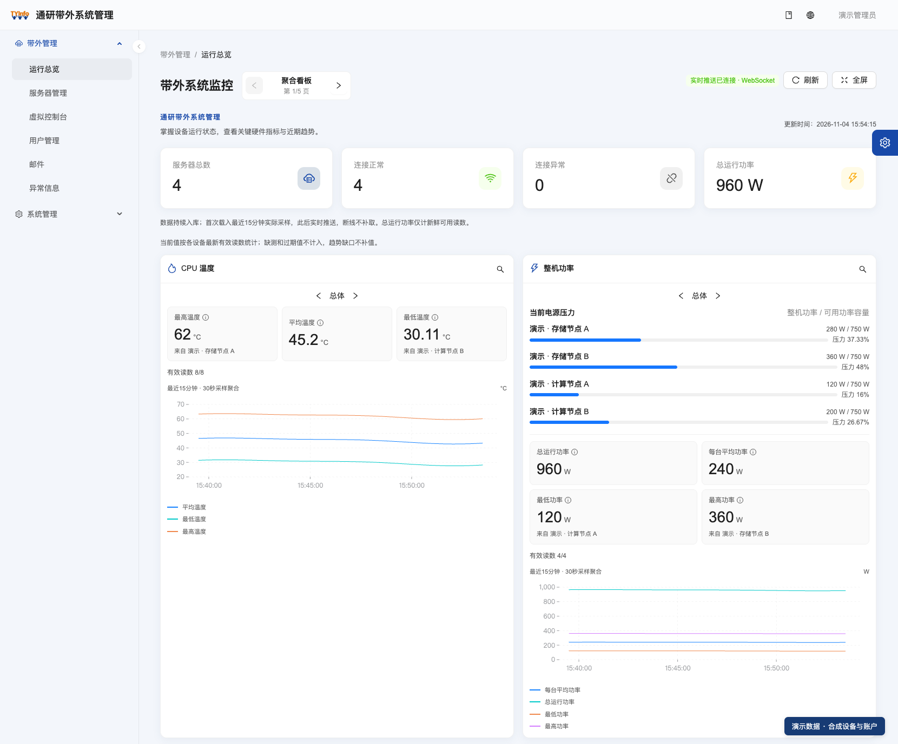
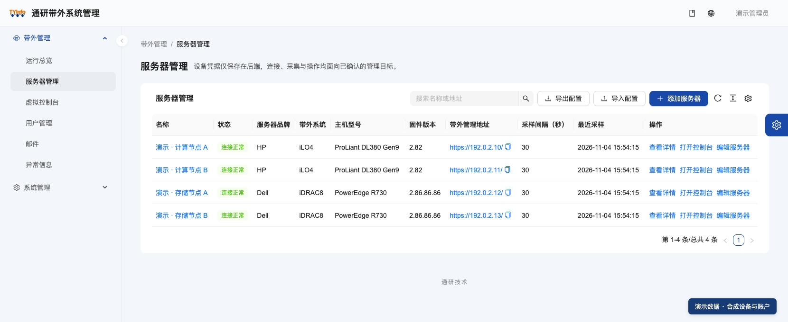
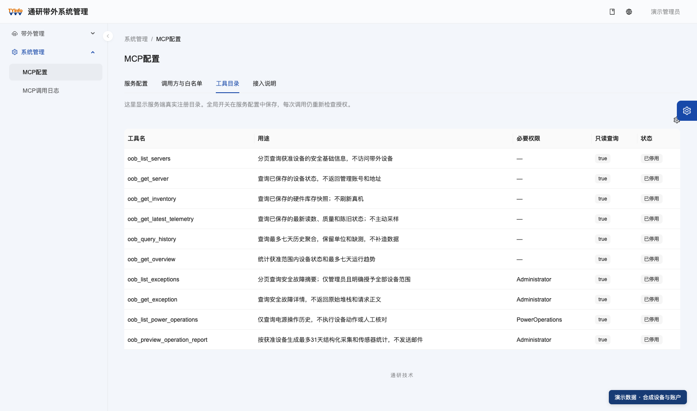

# 通研带外系统管理（tongyaninfo-OOB）

**统一管理服务器，让巡检、远程维护和 AI 数据查询更顺手。**

**通研官网**：[www.tongyaninfo.com](https://www.tongyaninfo.com/)

**产品官网**：[oob.tongyaninfo.com](https://oob.tongyaninfo.com/)

面向 HP iLO4、Dell iDRAC 8 的带外（Out-of-Band）管理工作台。把硬件库存、实时监控、历史趋势、虚拟控制台和运行报表集中到一个界面；通过 MCP（Model Context Protocol）为外部 AI 助手提供受控、结构化的运维数据。

本仓库是通研带外系统管理的开源版本，源码基线为 **1.0.0**，版本以根 [VERSION](VERSION) 为准。支持服务端集中部署和本地桌面运行。

[文档中心](docs/README.md) · [English](docs/README.en.md) · [参与贡献](CONTRIBUTING.md) · [安全策略](SECURITY.md) · [变更记录](CHANGELOG.md)

## 一屏掌握服务器状态



> 本仓库 README 截图来自实际 PC 界面，使用**合成演示数据**：设备名称、地址、账号和读数均为演示用途，不代表真实环境或真实客户。界面右下角另有“演示数据 · 合成设备与账户”提示。

## 功能概览

| 场景 | 系统能力 |
| --- | --- |
| 日常巡检 | CPU 温度、整机功率、风扇、阵列卡温度、进排气温度五类看板，默认最近 15 分钟趋势；每张卡片可独立切换总体与单台服务器，支持全屏展示。 |
| 设备与硬件管理 | 统一管理 iLO4、iDRAC 8 两类控制器：连接测试、库存刷新，查看 CPU、内存、电源、电池、控制器和磁盘信息。 |
| 历史回看 | 从看板进入历史搜索，选择一天、一周、一个月或自定义时间范围；保留缺测和中断，不把空值当作 0。 |
| 远程维护 | 最多四个虚拟控制台标签或浮窗，支持键鼠、全屏、屏幕键盘；浮窗可拖动缩放，切换系统菜单不丢失连接。 |
| 系统安装与镜像 | 支持本地 ISO 直接映射，以及按设备能力提供的 URL、平台镜像库挂载；本地文件无需先完整上传。 |
| 配置迁移 | 用密码加密的文件导入导出设备配置；覆盖已有设备时保留服务器 ID 与监控历史，并显示新增、覆盖、跳过数量。 |
| 运行报告 | 配置日报、周报、月报与收件人，也可按自选范围预览、下载 HTML。 |
| 个性化 | 简体中文、繁體中文、English；浅色、深色和跟随系统主题，按账号保存外观偏好。 |

监控读数保留单位、来源和时间。设备未提供的指标明确显示缺测、过期或不支持；采集成功率按采集结果统计。



完整操作说明：[中文使用指南](frontend/PC/docs/user-guide.zh-CN.md) · [English user guide](frontend/PC/docs/user-guide.en-US.md) · [繁體中文使用指南](frontend/PC/docs/user-guide.zh-TW.md)。

## AI 与 MCP 集成

系统通过服务端 **MCP（Model Context Protocol）** 提供十个只读查询工具。接入并授权支持相应 MCP/OAuth 流程的外部 AI 客户端后，可以用自然语言组织查询，让助手基于系统返回的数据整理巡检摘要、比较趋势、起草报告。

| 能力 | 说明 |
| --- | --- |
| 结构化输入与输出 | 工具声明 Schema，结果带版本；单位、UTC 时间、来源和数据质量随读数返回，长 ID 使用字符串。 |
| 覆盖设备到报告的查询 | 查询设备、硬件、最新监测、历史趋势、异常、电源记录和结构化运行统计。 |
| 按范围授权 | OAuth 授权码与 PKCE，绑定系统用户；工具、设备、网络白名单与当前业务权限共同决定可读范围，支持停用和撤销。 |
| 可追溯的调用记录 | 管理员可筛选调用日志，核对结果、耗时、错误码和关联标识；审计不保存凭据或任意请求、结果正文。 |

| 查询场景 | MCP 工具 |
| --- | --- |
| 设备清单与状态 | `oob_list_servers` · `oob_get_server` |
| 硬件与最新读数 | `oob_get_inventory` · `oob_get_latest_telemetry` |
| 历史趋势与总览 | `oob_query_history` · `oob_get_overview` |
| 异常查询 | `oob_list_exceptions` · `oob_get_exception` |
| 电源操作历史 | `oob_list_power_operations` |
| 运行报告统计 | `oob_preview_operation_report` |



**接入方式：** 服务端提供 `/mcp`，默认关闭。管理员完成目标环境迁移、HTTPS、签名与加密证书、调用方注册及白名单配置后，显式启用服务。系统侧无需配置大模型 API Key；外部 AI 客户端所需的模型服务由客户端自行配置。

MCP 查询已保存的数据，不主动采样；权限范围内可查询的历史/总览窗口最多 7 天，异常、电源记录和报表最多 31 天，另受点数等限额约束。MCP 不开放电源控制、UID、控制台输入、虚拟介质、发信或用户修改。桌面版不提供外部 MCP。

配置步骤、参数、权限与排错见 [MCP 接入说明](docs/api/mcp/README.md)；HTTP 调用方可使用 [REST 接口合同](docs/api/oob/README.md)。

## 技术栈与运行形态

| 方式 | 适用场景 | 组成与入口 |
| --- | --- | --- |
| 服务端 + 浏览器 | 集中运行采集、多人按权限使用、外部 AI 接入 | .NET 10 / EF Core + PostgreSQL 17 / TimescaleDB + React / Umi Max PC；[容器部署](deploy/oob/README.md)、[宿主部署](deploy/oob/HOST-SYSTEMD.md)。 |
| 本地桌面版 | 在管理电脑上独立使用 | Electron + 自包含 .NET 宿主 + SQLite，复用 PC 界面；普通运行无需 Node.js、.NET SDK、Docker 或外置数据库；[桌面说明](desktop/README.md)。 |

当前支持 HP iLO4、Dell iDRAC 8；控制台与虚拟介质取决于已审查的固件、设备能力与浏览器环境。H5 端仍处于规划阶段。桌面安装包的构建目标、实际平台验收和签名分开记录，详见桌面说明。

## 目录结构

```text
.
├── backend/                 # .NET 10 后端：四层 API/Application/Domain/Infrastructure
│   ├── src/                 #   业务源码
│   ├── tests/               #   驱动与集成测试
│   └── tools/               #   只读探针与离线接口合同导出工具
├── frontend/
│   ├── PC/                  # React 19 + Umi Max + Ant Design 6 PC 管理端
│   └── H5/                  # 移动端（规划中，当前仅目录说明）
├── desktop/                 # Electron 桌面宿主 + 自包含 .NET + SQLite
├── deploy/oob/              # Dockerfile、Compose、Nginx、systemd 与镜像示例
├── docs/                    # 架构、开发、接口、ADR、规范与截图
├── scripts/                 # 仓库检查链（doctor / verify / bootstrap / 合同导出）
├── Directory.Build.props    # .NET 公共属性（版本读取 VERSION）
├── Directory.Packages.props # .NET 集中包版本
├── global.json              # .NET SDK 版本
└── VERSION                  # 产品版本唯一来源
```

## 快速开始

### 环境要求

- .NET SDK 10.0.300（见 [global.json](global.json)）
- Node.js >= 22（PC 工程要求，见 `frontend/PC/package.json`）
- PostgreSQL 17 + TimescaleDB 2.31（仅服务端部署需要；桌面版使用 SQLite）

### 检查工具链

```sh
node scripts/doctor.mjs
```

### 后端

```sh
dotnet build backend/OobManagement.slnx
dotnet test backend/tests/OobManagement.Driver.Tests/OobManagement.Driver.Tests.csproj
```

集成测试连接真实 PostgreSQL；未配置数据库时请只运行驱动测试，或参考 [docs/development.md](docs/development.md) 配置测试库后如实记录结果。

### PC 管理端

```sh
npm --prefix frontend/PC ci --ignore-scripts --no-audit --no-fund
node frontend/PC/node_modules/@umijs/max/bin/max.js setup
npm --prefix frontend/PC run lint
npm --prefix frontend/PC test
npm --prefix frontend/PC run build
```

开发模式：`npm --prefix frontend/PC run dev`，默认打开 `http://127.0.0.1:8000`，`/api/` 同源代理到本机 API `http://127.0.0.1:5080`。

### 桌面版

```sh
npm --prefix desktop ci --ignore-scripts --no-audit --no-fund
npm --prefix desktop run typecheck
npm --prefix desktop test
npm --prefix desktop run build
```

完整安装包打包与签名见 [desktop/README.md](desktop/README.md)。

### 服务端运行

```sh
dotnet run --project backend/src/OobManagement.Api/OobManagement.Api.csproj --no-launch-profile
```

普通启动**不迁库、不创建管理员**；首次初始化、已有库升级和备份恢复按 [docs/development.md](docs/development.md) 与 [版本规约](docs/releases/README.md) 单独执行。真实电源控制默认关闭（`PowerControl.Enabled=false`），需要显式启用并具备对应权限。

## 配置与凭据

- 配置通过 `appsettings.json`、环境变量或部署注入的私有配置文件提供，示例见 [.env.example](.env.example)。
- **仓库不包含任何真实凭据**：BMC 账号密码、数据库密码、SMTP 口令、OAuth 签名/加密证书与私钥均由部署者通过环境变量或私有目录注入。
- 部署私有文件（`application.json`、数据库连接、密码文件、证书）不进入源码；示例文件中的占位符必须以 `CHANGE_...` 或环境变量替换。

## 验证与检查链

```sh
node scripts/verify.mjs --scope docs   # 文档路径与检查链
node scripts/verify.mjs                # 构建 + 测试 + 合同检查（需要完整工具链）
```

检查链说明见 [scripts/README.md](scripts/README.md)。

## 电源与设备操作边界

真实电源控制默认关闭，需要用户显式启用、具备对应权限并确认目标服务器名称。系统记录操作意图；结果未知时按原请求核对，避免重复发送。UID、控制台输入与介质挂载也须由使用者明确操作。AI 代执行真实电源动作须逐次取得具体服务器、动作和时机的授权。

## 安全

BMC 凭据、MCP OAuth 证书与部署配置属于敏感信息。发现安全问题请按 [SECURITY.md](SECURITY.md) 的渠道报告，不要在公开 Issue 中披露漏洞细节或真实凭据。

## 参与贡献

欢迎提交 Issue 与 Pull Request。流程、分支与提交信息规范见 [CONTRIBUTING.md](CONTRIBUTING.md)；AI 协作约定见 [AGENTS.md](AGENTS.md)。

## 许可与第三方声明

本项目以 [Apache License 2.0](LICENSE) 开源。PC 管理端基于 [Ant Design Pro](https://github.com/ant-design/ant-design-pro) 模板（MIT）构建，模板衍生部分与第三方素材的许可声明见 [NOTICE](NOTICE)。实时监控数据库使用 TimescaleDB，其社区版采用 Timescale License（TSL），部署前请自行核对许可义务。

> README 中的界面截图使用合成演示数据；设备名称、地址、账号与读数不代表真实环境。
