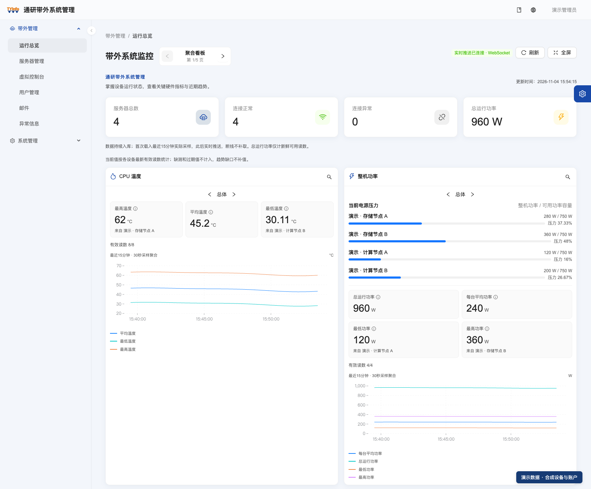
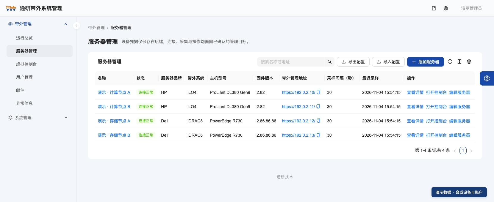
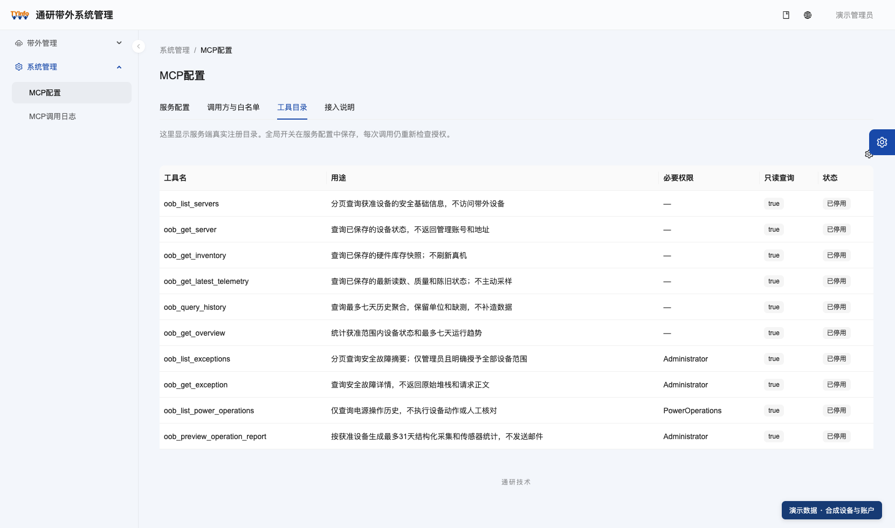

# Tongyan Out-of-Band Management

**Manage servers in one place, with convenient health checks, remote maintenance, and AI data access.**

[Official website](https://www.tongyaninfo.com) · [简体中文](README.md) · [English](README.en.md) · [Repository home](../README.md)

An out-of-band management workspace for HP iLO4 and Dell iDRAC 8. Hardware inventory, live monitoring, historical trends, virtual consoles, and operation reports share one interface. MCP gives external AI assistants controlled access to structured operational data.

The current product source baseline is **1.0.0**, with the root [VERSION](../VERSION) as the source of truth. The system supports centralized server deployment and local desktop use; see [Deployment options](#deployment-options).

## Server status at a glance



> These screenshots show the actual PC interface with synthetic demonstration data. Device names, addresses, accounts, and readings do not represent a real environment.

## Fewer steps in everyday work

| What you need to do | How the system helps |
| --- | --- |
| Run a quick morning health check | Five dashboard categories cover CPU temperature, system power, fans, array controller temperature, and inlet/exhaust temperature. View the last 15 minutes by default, switch each card independently between all servers and one server, or use fullscreen. |
| Find a device and inspect its hardware | Manage both controller families in one place, test connections, refresh inventory, and inspect CPUs, memory, power supplies, batteries, controllers, and disks. |
| Review a particular period | Open history search directly from a dashboard card and choose a day, week, month, or custom range. Missing readings and interruptions remain visible so you can assess data completeness. |
| Maintain several hosts remotely | Open up to four console tabs or floating windows, with keyboard/mouse input, fullscreen, and an on-screen keyboard. Move and resize floating windows while retaining the connection as you navigate between system menus. |
| Install an operating system or mount an image | Map a local ISO directly, or use a URL or platform image library where the device supports it. Local files do not need to be uploaded in full first. |
| Move or hand over device configurations | Import and export configurations in password-encrypted files. Updating an existing device preserves its server ID and monitoring history, with counts for added, updated, and skipped entries. |
| Prepare routine operation reports | Configure daily, weekly, and monthly reports and recipients, or preview and download HTML for a chosen range, reducing repeated work collecting acquisition and sensor statistics. |
| Work in your preferred language and theme | Choose Simplified Chinese, Traditional Chinese, or English, with light, dark, or system-following themes. Appearance preferences are saved per account. |

Readings retain their units, sources, and timestamps. Unavailable device metrics are explicitly marked as missing, stale, or unsupported. Collection success rates are calculated from collection outcomes.



Full instructions: [Chinese user guide](../frontend/PC/docs/user-guide.zh-CN.md) · [English user guide](../frontend/PC/docs/user-guide.en-US.md). The book icon at the top right of the application also opens the user documentation in all three languages.

## AI-friendly access to operational data

The server provides ten read-only query tools through **MCP (Model Context Protocol)**. After connecting and authorizing an external AI client that supports the required MCP/OAuth flow, you can express queries in natural language and have the assistant use returned data to summarize health checks, compare trends, and draft reports, reducing manual navigation and copying.

### Example requests

- “Summarize the current status of the servers I can access, and identify any stale readings.”
- “Show CPU temperature and system power trends for the example server over the last 24 hours, keeping any missing-data notes.”
- “Draft an operation report from collection and sensor statistics for the specified period.” (Administrator permission required.)
- “Find recent power operation records for this server.” (Power Operations permission required; this only queries history.)

These are examples for an external AI client. The connected model generates summaries and explanations; review them against the original readings and any data gaps.

### Capabilities prepared for AI integration

| Capability | Practical benefit |
| --- | --- |
| Structured inputs and outputs | Tools declare schemas and return versioned results. Units, UTC timestamps, sources, and data quality accompany readings; long IDs use strings so clients can handle them accurately. |
| Queries from devices to reports | Retrieve devices, hardware, latest telemetry, historical trends, exceptions, power operation records, and structured operation statistics. |
| Scoped authorization | OAuth authorization code flow with PKCE binds access to a system user. Tool, device, and network allowlists combine with current business permissions to define what can be read, with support for disabling and revoking access. |
| Traceable calls | Administrators can filter call logs and inspect outcomes, duration, error codes, and correlation identifiers. Audit logs exclude credentials and arbitrary request or result bodies. |

| Query scenario | MCP tools |
| --- | --- |
| Device list and status | `oob_list_servers` · `oob_get_server` |
| Hardware and latest readings | `oob_get_inventory` · `oob_get_latest_telemetry` |
| Historical trends and overview | `oob_query_history` · `oob_get_overview` |
| Exceptions | `oob_list_exceptions` · `oob_get_exception` |
| Power operation history | `oob_list_power_operations` |
| Operation report statistics | `oob_preview_operation_report` |



**Connecting a client:** The server exposes `/mcp`, disabled by default. An administrator must complete the target environment's migrations, HTTPS setup, signing and encryption certificates, client registration, and allowlists, then explicitly enable the service. The user must consent to authorization. No large language model API key is required in this system; the external AI client configures its own model service.

MCP queries saved data and does not trigger new sampling. Within the permitted scope, history and overview queries allow windows of up to 7 days; exceptions, power records, and reports allow up to 31 days, with additional limits such as point counts. MCP does not expose power control, UID changes, console input, virtual media operations, email sending, or user modifications. The current desktop edition does not provide external MCP. Validate target client compatibility against the actual client version.

For setup, parameters, permissions, and troubleshooting, see the [MCP integration guide](api/mcp/README.md). HTTP clients can use the [official REST contracts](api/oob/README.md).

## Deployment options

| Option | Suitable for | Components and guides |
| --- | --- | --- |
| Server + browser | Centralized collection, permission-based access for multiple users, and external AI integration | .NET 10 / EF Core + PostgreSQL 17 / TimescaleDB + React / Umi Max PC; [container deployment](../deploy/oob/PODMAN.md), [host deployment](../deploy/oob/HOST-SYSTEMD.md). |
| Local desktop edition | Independent use on a management computer | Electron + a self-contained .NET host + SQLite, reusing the PC interface. Normal use requires no Node.js, .NET SDK, Docker, or external database; see [desktop usage and packaging](../desktop/README.md). |

Current device support covers HP iLO4 and Dell iDRAC 8. Console and media capabilities depend on reviewed firmware, device support, and the browser environment. H5 remains planned. Desktop build targets, actual platform acceptance, and signing are recorded separately; see the desktop guide.

## Getting started

Start with the [deployment guide](../deploy/README.md) or [local desktop guide](../desktop/README.md), depending on how you intend to use the system. The following commands are for a local development environment with the toolchain, private configuration, and database already prepared:

```sh
# Check the toolchain without installing dependencies or accessing devices
node scripts/doctor.mjs

# Restore project dependencies from lockfiles for the first time
node scripts/bootstrap.mjs
```

From the repository root, run the following in two separate terminals:

```sh
dotnet run --project backend/src/OobManagement.Api/OobManagement.Api.csproj --no-launch-profile
```

```sh
npm --prefix frontend/PC run dev
```

Open `http://127.0.0.1:8000`. The API runs at `http://127.0.0.1:5080`, accessed by the PC through a same-origin proxy. After login, the default page is `/oob/overview`. Local initialization supplies the account and password; public documentation contains no default password.

Normal startup does not migrate the database or create an administrator. It starts read-only sampling for enabled devices. Perform initial setup, existing database upgrades, and backup restoration separately, following the [development guide](development.md) and [versioning rules](releases/README.md).

## Power operation boundaries

Real power control defaults to `PowerControl.Enabled=false`. A user must explicitly enable it, hold the required permission, and confirm the target server name. The system records operation intent. When the outcome is unknown, check the original request to avoid sending a duplicate. UID changes, console input, and media mounting also require explicit user actions.

An AI agent executing a real power action must obtain authorization for the specific server, action, and timing on every occasion. See [manual power validation](development.md#用户人工电源验证) for the process.

## Documentation center

| Topic | Document |
| --- | --- |
| Project overview and quick start | [Root README](../README.md) |
| Architecture and stack | [Architecture](architecture.md) |
| Development, configuration, and troubleshooting | [Development](development.md) |
| Glossary | [Glossary](glossary.md) |
| API contracts | [API documentation](api/README.md) |
| Versioning and upgrades | [Versioning rules](releases/README.md) |
| Design decisions | [ADRs](adr/README.md) |
| Phase-one scope | [Phase-one plan](spec/带外管理系统一期实施方案.md) |
| Database design | [ER reference](er/README.md) |

## Verification

```sh
node scripts/verify.mjs --scope docs
node scripts/verify.mjs
```

The unified checks support docs/frontend/backend/all scopes, with `all` as the default. See [verification tools](../scripts/README.md) for scope and environment requirements.

Actual browser, device, SMTP, and external AI client acceptance is recorded separately and is not implied by automated checks.
