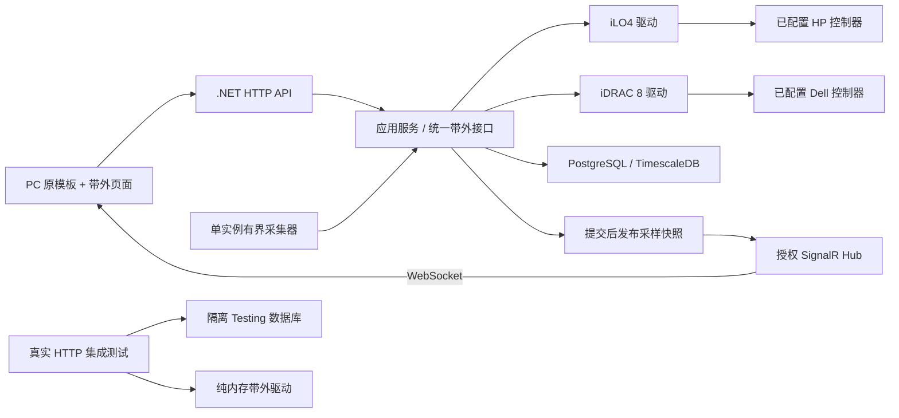

# 架构地图

本文件描述带外管理工程的当前实现。需求和业务边界见[一期方案](spec/带外管理系统一期实施方案.md)，运行见[开发手册](development.md)，接口见[API](api/oob/README.md)。目录、模块状态与实现分别表述，不把规划写成已实现。

## 当前模块

| 模块 | 状态与职责 | 边界 |
| --- | --- | --- |
| `backend/src` | 四层 .NET 10/EF Core 应用 | Api 组装；Application 服务接口；Infrastructure 存储/驱动；Domain 模型 |
| `backend/tests` | 驱动与真实 PostgreSQL HTTP 集成测试 | 集成测试用 Testing 库与模拟驱动，禁用真机采集 |
| `frontend/PC` | 独立 Ant Design Pro/Umi Max 应用 | 登录与运行首页采用通研品牌设计，头像、语言与主题保留；模板演示页已移除，只保留登录、异常页、账户设置、系统管理与业务页面 |
| `frontend/H5` | 仅规划与规则 | 本期未建立移动应用 |
| `docs/api/oob` | 实际路由清单与 DTO JSON Schema | PC 生成类型同源，不手改生成字段 |
| `backend/tools/OobContracts` | 独立离线合同工程 | 只解析 MVC/端点和 JSON 元数据，无配置、业务服务或监听 |
| `docs/api/mcp` | MCP/OAuth 配置和接入说明 | 十个查询工具，默认关闭；实际客户端兼容另验 |
| `deploy/oob` | 独立 PostgreSQL 17/TimescaleDB Compose | 新容器/卷/开发测试库，不复用其他项目资源 |
| `.local/oob`（部署私有目录） | 被忽略的私密配置、密钥与缓存 | 不进入共享文档、前端、合同或日志；由部署者通过环境变量或私有目录注入 |
| `desktop` | Electron、本地 .NET 宿主与独立 SQLite 迁移 | 复用 PC/Controller/业务/驱动，数据位于每用户目录；原服务端 PostgreSQL 保留 |



统一控制台使用独立会话与 WebSocket 网关，不经过遥测 Hub。厂商适配器只公开已审查的 HTML5 解码器依赖和固定协议通道，设备认证保留在后端，原生管理页面、电源与配置接口不透传。PC 自有画布外壳通过校验来源、窗口及会话标识的消息接收键鼠和本地 ISO File，连接/输入与介质状态分别报告。具体范围见统一控制台变更。

桌面宿主与服务端通过 `OobApplication` 共用应用组装。共享业务持有 `OobDbContext` 工厂，默认使用 PostgreSQL 存储策略；桌面返回 SQLite 子类，单独处理账号锁、约束错误、UTC微秒映射和数据库时间桶，迁移互不替代。首次初始化/升级显式确认，未就绪时阻断业务与后台采集，详见[桌面说明](../desktop/README.md)和[ADR-0011](adr/ADR-0011-本地桌面宿主与SQLite存储.md)。

可选镜像库和挂载意图采用仓库外独立业务文件，无 EF 结构变更。追加日志在发送介质动作前落盘，镜像来源 URL 加密、供给凭据只存摘要；独占文件租约限定单实例写入，重启只恢复状态并查询核对，不自动重发动作。控制台关闭不撤销 URL/镜像库挂载；显式卸载确认后才撤销相应供给授权，不自动删除镜像文件。部署、配额及检查边界见[运行手册](development.md#统一虚拟控制台与介质)。

## 后端分层

单邮箱发件复用四层及宿主组装，配置和发件意图/结果分别存于`OOB_MAIL_CONFIGURATION`、`OOB_MAIL_MESSAGE`。MailKit仅存在于Infrastructure协议实现，普通正文为纯文本、单收件人；管理员通过独立入口使用。无后台邮件队列，读取不发信；稳定请求标识和提交前持久化避免重复调用，重启遗留Sending只读投影为Unknown。数据库与宿主密钥共同参与原有桌面备份，见邮件迁移。

运行报表在现有两表追加计划JSON和HTML快照，由单实例后台服务核对明确启用的日周月计划。上海自然周期转UTC聚合已入库轮次/有效传感器/异常，HTML资源由API的Resources目录发布，桌面复用。保存、预览和下载没有发件副作用，定时发送携带期望配置版本并在提交前复核；按固定周期与统计窗口防重，离线仅处理最近到期一期。初始化、合同导出和Testing环境不启动报表调度，桌面在数据库就绪后才启动。

当前解决方案为 [OobManagement.slnx](../backend/OobManagement.slnx)。

| 层 | 内容 | 允许依赖 |
| --- | --- | --- |
| Domain | Models：实体、枚举、领域概念 | 无 |
| Application | Models/Service：DTO、ApiResult、服务接口 | Domain |
| Infrastructure | Persistence、Common、Service/impl：EF、认证、驱动、采集与设置 | Application、Domain |
| Api | Controller、认证防伪、序列化、MCP/OAuth 与 DI | Application、Domain、Infrastructure（宿主组装） |

实体、接口和实现分类组织；Api 不能因项目引用合法而绕开服务接口访问存储。设备读写接口与业务事务分离，普通主键复用 IIdService，设备密码加密后存储。

## 数据与状态

业务表覆盖用户、账号设置、服务器、硬件快照、指标系列、采样、采集记录、电源操作意图、系统异常、邮件及 MCP 配置/授权/审计。异常表是普通表，独立于采样超表；日志先脱敏缓冲，再用独立 DbContext 入库，见[ADR-0009](adr/ADR-0009-异常记录与业务结果分离.md)。EF 迁移维护结构与中文注释，业务及 OAuth 分别遵守自己的版本链，只有显式初始化/迁移命令执行；普通启动不自动迁库。

采样表使用时间分区与 `(SeriesId, SampledAt)` 主键，UTC 入库；单位和可用性随读数保存。单实例内按服务器互斥，有界并发、超时与失败退避；本期没有分布式租约或多副本采集保障。历史查询保留空值断点，不自动删除原始数据。

每轮采样保存成功后通过 Application 发布接口向 SignalR 发布 `ServerTelemetryDto`，无浏览器时仍持续入库。有界后台队列隔离慢客户端，入队时固定订阅连接标识，积压淘汰旧事件且新连接不接旧队列消息。Api Hub 只提供授权推送，限定 WebSocket 和握手来源，不提供设备写入方法。总览首次取快照和最近15分钟历史，此后直接合并推送；按每服务器持久化版本隔离旧响应/乱序事件。重连不补取快照、历史或离线消息，断线段保留缺口。当前为单实例分发，未配置跨实例 backplane。

电源动作经身份、CSRF、全局开关、设备能力、名称确认和幂等意图校验。发送后未知保持待核对，不自动重发；代码具备电源路径不代表获准执行真机动作，人工边界见[运行手册](development.md#用户人工电源验证)。

## 合同来源

MCP 和 OAuth 接入由 Api 适配，授权/范围查询/审计继续通过 Application 接口。调用方的同意快照与当前用户、工具、设备及网络规则每请求取交集，设备范围先进入 SQL；停用或修改配置后取消当前进程中的活跃查询，返回前再次核验。七张 MCP 业务表沿用 OobDbContext 的 PostgreSQL/SQLite 链；OAuth 组件的授权、客户端和令牌由独立 McpOAuthDbContext 管理，采用独立迁移历史。桌面强制关闭外部 MCP，不开放动态回环端口或 LAN 介质监听。依赖固定 ModelContextProtocol.AspNetCore 2.3.0、OpenIddict 7.5.0，详见[ADR-0012](adr/ADR-0012-MCP服务授权与离线合同.md)与[MCP接入](api/mcp/README.md)。本地实现不构成生产发布或全部客户端兼容证明。

```text
后端实际 Controller / EndpointDataSource / DTO / JSON 序列化元数据
  → backend/tools/OobContracts（独立元数据容器，不启动业务宿主）
  → scripts/oob-contracts.mjs（不读取私密配置或运行后台服务）
  → docs/api/oob/routes.json、schemas.json
  → 固定 json-schema-to-typescript 16.0.0
  → frontend/PC/src/services/oob/generated.ts
  → models.ts 类型别名 / 请求层 / 页面
```

生成落在仓库外临时目录，check 将三份正式制品逐字比较；generate 才更新正式文件。生成、类型、HTTP 行为、真机读取和用户电源验收分别证明不同层次。

Swagger/OpenAPI 的服务、UI、模板插件及旧生成依赖已退役。`generated.ts` 保留 `components.schemas` 以兼容现有消费者，格式本身不代表仍有 OpenAPI 服务。MCP 工具 Schema 单独从工具目录公开，不能替代完整 REST 合同。

## 检查入口与边界

[检查链](../scripts/README.md)采用 docs/frontend/backend/all，默认 all 覆盖当前正式工程；GitHub Actions 工作流见 [.github/workflows/ci.yml](../.github/workflows/ci.yml)。检查链不执行 Git、不访问真实设备。新增工程与公开入口时同步更新本图、开发手册和检查矩阵，不能把规划或目录存在写成已实现。
